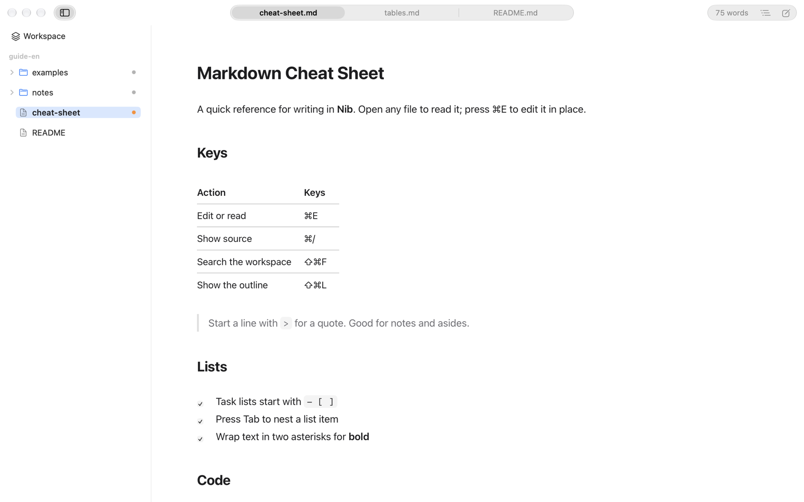

<p align="center">
  
</p>

<h1 align="center">Nib</h1>

<p align="center">
  Open a Markdown file. Read it as a page.<br>
  A native Mac app that opens <code>.md</code> files rendered, lets you edit them in place,<br>
  and saves back only what you changed. Free and open source.
</p>

<p align="center">
  <a href="https://github.com/chengffei/nib/releases/latest/download/Nib.dmg"><b>Download</b></a> ·
  <a href="https://chengffei.github.io/nib/">Website</a>
</p>

<p align="center">
  <b>English</b> ·
  <a href="README.zh-Hans.md">简体中文</a>
</p>

<p align="center">
  
</p>

## Why Nib

More and more Markdown is written by something other than you: coding agents, scripts, build tools, the notes app on your phone. You mostly read it, and now and then fix a line. Nib is made for that.

- **It opens as a page.** Headings, tables, checklists and code are rendered the moment the file opens. Links are clickable. Nothing to type into by accident.
- **Press `⌘E` to edit, right there.** Only the line you're on shows its Markdown. Everything else stays rendered, the way Typora works. `⌘/` shows the whole source.
- **It leaves your file alone.** Saving writes back your edits and nothing else. Line endings, blank lines and untouched lines stay byte for byte, so `git diff` shows only what you changed.
- **It keeps up.** When a terminal, script or agent rewrites a file, Nib reloads it in about a tenth of a second.

## For the Markdown your tools write

- **One window, many tabs.** Every file you open, from Finder, the terminal or a link, joins the same window as a tab. `⌘1`–`⌘9` jumps between them.
- **A workspace with git dots.** Add folders to the sidebar (`⌃⌘S`). Files changed since the last commit get an orange dot, new files a green one. The dots update as soon as something commits.
- **Find anything.** `⇧⌘O` opens files by name. `⇧⌘F` searches every Markdown file in the workspace and jumps to the line. A folder of 2,500 files takes under a quarter of a second.
- **Always ready.** Close the last window and Nib steps out of the Dock but stays ready. The next file opens in about 0.15 s.
- **Light on memory.** Tabs you haven't looked at in a while go to sleep and wake up where you left them.

## For writing

- **Paste a screenshot.** It's saved next to the document in `name.assets/` and linked with a relative path. Typora's `typora-copy-images-to` is honored.
- **Paste from the web.** Rich text from browsers, Google Docs and Feishu becomes clean Markdown. `⌥⇧⌘V` pastes plain text.
- **Tables and task lists.** CommonMark and GitHub Flavored Markdown. `Tab` indents lists, and nested ordered lists number 1, a, i.
- **Outline, focus and typewriter.** `⇧⌘L` shows the outline. `F8` dims everything but the current paragraph. `F9` keeps the line you're typing in the middle.
- **Headings you can tell apart.** In edit mode, small H1–H6 marks sit in the margin.
- **Word count** in the title bar, counted the way Typora counts.
- **Export.** Print, or export a PDF or a single-file HTML with images embedded.

## Make it yours

- **Themes.** Light, dark, warm paper, or follow the system. Nib also reads [Typora themes](Nib/Resources/docs/themes.md): drop a theme's CSS into `~/Library/Application Support/Nib/themes`.
- **Type.** Body and code fonts, size, line height and paragraph spacing.
- **Shortcuts.** Change the keys for 13 commands in Settings.
- **Eight languages.** English, Simplified Chinese, Traditional Chinese, Japanese, Korean, French, German and Spanish.

## How it compares

- **Typora** is the model for editing in place. It's paid, built on Electron, and opens files in edit mode.
- **MarkEdit** is native and open source too, but it's a source editor: you see Markdown with highlighting, not the rendered page.
- **Obsidian** is built around a vault, plugins and links between notes. Nib opens any `.md` where it is.

Nib is for people who read more Markdown than they write.

## What it doesn't do

- No plugins, sync or account.
- No math or Mermaid diagrams yet.
- Raw HTML in a file isn't rendered. The view is a web view, and a file you downloaded shouldn't be able to run scripts.

## Install

1. Download [Nib.dmg](https://github.com/chengffei/nib/releases/latest/download/Nib.dmg) and drag Nib to Applications.
2. Nib isn't notarized by Apple, so macOS blocks it the first time. Open it and click **Done**. Then go to **System Settings › Privacy & Security**, scroll down and click **Open Anyway**.
3. To make Nib the default for Markdown, select any `.md` file in Finder, press `⌘I`, choose Nib under **Open with**, and click **Change All**.

Requires macOS 15 or later. Universal app for Apple silicon and Intel.

## Shortcuts

| Action | Keys |
|---|---|
| Edit / read | `⌘E` |
| Source | `⌘/` |
| Quick open | `⇧⌘O` |
| Search the workspace | `⇧⌘F` |
| Find in document | `⌘F` |
| Sidebar | `⌃⌘S` |
| Outline | `⇧⌘L` |
| Focus / typewriter | `F8` / `F9` |
| Switch tabs | `⌘1`–`⌘9`, `⇧⌘[` `⇧⌘]` |
| Reopen closed tab | `⇧⌘T` |
| Text size | `⌘=` `⌘-` `⌘0` |

## Build from source

Requires Xcode 26, Node.js and [XcodeGen](https://github.com/yonaskolb/XcodeGen).

```sh
cd Web && npm install && npm run build && cd ..   # bundle the editor core into Nib/Editor
xcodegen generate
xcodebuild -project Nib.xcodeproj -scheme Nib -configuration Release -derivedDataPath .build/DerivedData build
```

The app is in `.build/DerivedData/Build/Products/Release/Nib.app`. The shell is SwiftUI and AppKit in `Nib/`; the editor core is [CodeMirror 6](https://codemirror.net/) in `Web/src/`.

## Credits

Editing by [CodeMirror 6](https://codemirror.net/). Reading view and export by [markdown-it](https://github.com/markdown-it/markdown-it). Web paste by [Turndown](https://github.com/mixmark-io/turndown). All bundled packages and their licenses are listed in [THIRD-PARTY-NOTICES.md](THIRD-PARTY-NOTICES.md). Nib reads the Typora theme format but ships no Typora code or themes, and isn't affiliated with Typora.

## Contributing

Issues and pull requests are welcome. Code contributions require agreeing to the [Contributor License Agreement](CLA.md).

## License

[GPL-3.0](LICENSE).
