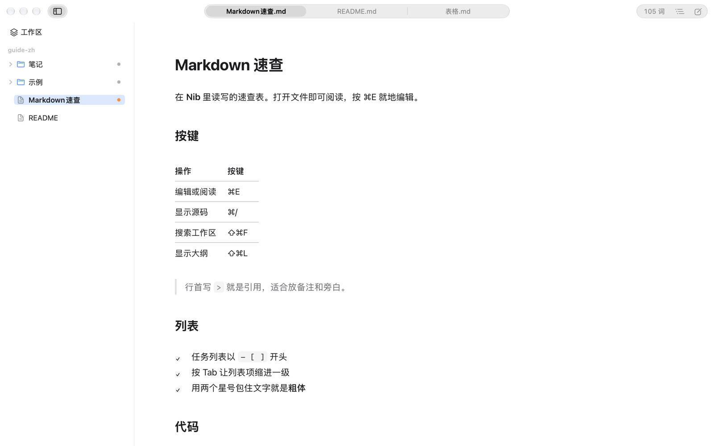

<p align="center">
  
</p>

<h1 align="center">Nib</h1>

<p align="center">
  打开 Markdown，看到的就是排好版的文档。<br>
  原生 Mac 应用：打开即渲染，就地修改，存盘只写回你改过的地方。免费开源。
</p>

<p align="center">
  <a href="https://github.com/chengffei/nib/releases/latest/download/Nib.dmg"><b>下载</b></a> ·
  <a href="https://chengffei.github.io/nib/zh/">官网</a>
</p>

<p align="center">
  <a href="README.md">English</a> ·
  <b>简体中文</b>
</p>

<p align="center">
  
</p>

## 为什么是 Nib

现在越来越多的 Markdown 不是你自己写的：编程 Agent 写的方案，脚本生成的报告，构建工具吐出的文档。你多半是在读，偶尔改一行。Nib 就为这件事而做。

- **打开就是成品。** 标题、表格、清单、代码块一打开就排好版，链接可以直接点，不会误触改动。
- **`⌘E` 就地改。** 只有光标所在那行露出 Markdown 语法，其余照样是排好的样子，手感和 Typora 一样。`⌘/` 看整篇源码。
- **不动你的文件。** 存盘只写回你改的地方。换行符、空行、没碰过的行一个字节都不变，`git diff` 里只有你的改动。
- **跟得上。** 终端、脚本或 Agent 改写了文件，Nib 约 0.1 秒内自动刷新。

## 为工具写的 Markdown 而做

- **一个窗口，多个标签。** 从访达、终端或链接打开的文件，都并进同一个窗口的标签页。`⌘1` 到 `⌘9` 切换。
- **带 git 圆点的工作区。** 把文件夹加进侧栏（`⌃⌘S`）。上次提交后改过的文件标橙点，新文件标绿点，一提交圆点就跟着变。
- **什么都找得到。** `⇧⌘O` 按文件名打开，`⇧⌘F` 搜整个工作区的 Markdown 并跳到那一行。2500 个文件的文件夹，不到 0.25 秒。
- **随叫随到。** 关掉最后一个窗口后，Nib 离开 Dock 但不退出，下一个文件约 0.15 秒打开。
- **省内存。** 久未查看的标签自动休眠，切回来还在原处。

## 写的时候

- **粘贴截图。** 存到文档旁的「文档名.assets」文件夹，插入相对路径。兼容 Typora 的 `typora-copy-images-to`。
- **从网页粘贴。** 浏览器、Google Docs、飞书里的富文本转成干净的 Markdown。`⌥⇧⌘V` 粘贴纯文本。
- **表格与任务列表。** 支持 CommonMark 与 GitHub 风格 Markdown。`Tab` 调列表层级，嵌套有序列表按 1、a、i 编号。
- **大纲、专注、打字机。** `⇧⌘L` 看大纲，`F8` 只亮当前段落，`F9` 让正在写的行停在屏幕中间。
- **标题层级一眼可辨。** 编辑模式下，左侧留白标出 H1 到 H6。
- **字数** 显示在标题栏，口径与 Typora 一致。
- **导出。** 打印，或导出 PDF、图片内嵌的单文件 HTML。

## 按你的习惯

- **主题。** 浅色、深色、暖纸或跟随系统。也能读 [Typora 主题](Nib/Resources/docs/themes.zh-Hans.md)：把主题 CSS 放进 `~/Library/Application Support/Nib/themes`。
- **字体。** 正文与代码字体、字号、行高、段落间距。
- **快捷键。** 设置里可改 13 个命令的按键。
- **8 种界面语言。** 简体中文、繁体中文、英语、日语、韩语、法语、德语、西班牙语。

## 和其他工具比

- **Typora** 是就地编辑的样板。它收费、基于 Electron，打开文件默认进入编辑。
- **MarkEdit** 同样原生、开源，但它是源码编辑器：你看到的是高亮的 Markdown，不是排好的版面。
- **Obsidian** 围绕仓库、插件和笔记互链。Nib 直接打开任意位置的 `.md`。

Nib 适合读 Markdown 比写得多的人。

## 不做什么

- 没有插件、同步和账号。
- 暂不支持数学公式和 Mermaid 图。
- 不渲染文件里的原始 HTML。显示层是网页视图，下载来的文件不该能跑脚本。

## 安装

1. 下载 [Nib.dmg](https://github.com/chengffei/nib/releases/latest/download/Nib.dmg)，把 Nib 拖进「应用程序」。
2. Nib 没有经过 Apple 公证，第一次打开会被拦下。先打开一次并点「完成」，再到「系统设置 › 隐私与安全性」拉到底部，点「仍要打开」。
3. 想让 `.md` 默认用 Nib 打开：在访达里选中任意 `.md`，按 `⌘I`，「打开方式」选 Nib，点「全部更改」。

需要 macOS 15 或更高。通用应用，Apple 芯片与 Intel 都能用。

## 快捷键

| 操作 | 按键 |
|---|---|
| 编辑 / 阅读 | `⌘E` |
| 源码 | `⌘/` |
| 快速打开 | `⇧⌘O` |
| 搜索工作区 | `⇧⌘F` |
| 文档内查找 | `⌘F` |
| 侧栏 | `⌃⌘S` |
| 大纲 | `⇧⌘L` |
| 专注 / 打字机 | `F8` / `F9` |
| 切换标签 | `⌘1` 到 `⌘9`，`⇧⌘[` `⇧⌘]` |
| 重新打开关掉的标签 | `⇧⌘T` |
| 字号 | `⌘=` `⌘-` `⌘0` |

## 从源码构建

需要 Xcode 26、Node.js 和 [XcodeGen](https://github.com/yonaskolb/XcodeGen)。

```sh
cd Web && npm install && npm run build && cd ..   # 把编辑器内核打包进 Nib/Editor
xcodegen generate
xcodebuild -project Nib.xcodeproj -scheme Nib -configuration Release -derivedDataPath .build/DerivedData build
```

产物在 `.build/DerivedData/Build/Products/Release/Nib.app`。外壳是 `Nib/` 里的 SwiftUI 与 AppKit，编辑器内核是 `Web/src/` 里的 [CodeMirror 6](https://codemirror.net/)。

## 致谢

编辑基于 [CodeMirror 6](https://codemirror.net/)，阅读视图与导出基于 [markdown-it](https://github.com/markdown-it/markdown-it)，网页粘贴基于 [Turndown](https://github.com/mixmark-io/turndown)。打包的全部依赖及其许可证见 [THIRD-PARTY-NOTICES.md](THIRD-PARTY-NOTICES.md)。Nib 兼容 Typora 主题格式，但不含 Typora 的代码或主题，与 Typora 无关。

## 参与贡献

欢迎提 issue 和 pull request。提交代码需要同意[贡献者许可协议](CLA.md)。

## 许可证

[GPL-3.0](LICENSE)。
